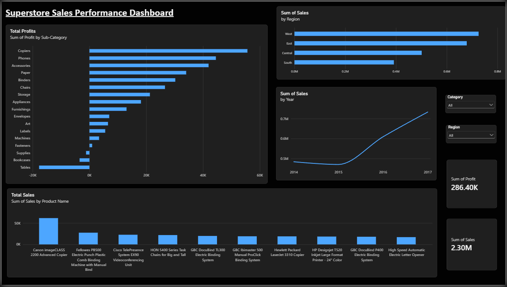

# superstore-sales-analysis
Superstore Sales Analysis
End-to-end sales analysis of the Sample Superstore dataset (9,994 orders, 2014-2017) using Excel, SQL (SQLite) and Power BI.

Objective
Understand sales trends, regional performance, top products and profitability by sub-category, and find where the business is losing money.
Tools
Excel / Power Query: data cleaning and validation
SQL (SQLite, DB Browser): aggregation and analysis
Power BI: interactive dashboard
Process
Cleaning and validation (Excel): confirmed 9,994 rows, 0 duplicates, 0 blanks and no orders shipped before they were placed. Added Year, Month and Profit Margin columns.
Analysis (SQL): queried sales and profit by year, region, product and sub-category. All queries are in `superstore_analysis.sql`.
Dashboard (Power BI): KPI cards, sales trend, regional and product charts, and region/category filters. File: `Superstore_Dashboard.pbix`.
Key findings
Totals: $2.30M in sales and $286K in profit (12.5% margin).
Growth: sales grew from $484K (2014) to $733K (2017), up 51%. Profit grew from $49.5K to $93.4K, up 89%. Margin improved from 10.2% to 12.7%.
Regions: West is the strongest (14.9% margin on $725K sales). Central is the weakest (7.9% margin on $501K sales).
Products: the Canon imageCLASS 2200 Copier is the top seller ($61.6K sales, $25.2K profit). 3 of the top 10 best-selling products lost money.
Loss-making sub-categories:
Sub-category |	Sales	| Profit |
Tables	$206,966	-$17,725
Bookcases	$114,880	-$3,473
Supplies	$46,674	-$1,189
Suggested next steps
Analyze discounting on Tables and Bookcases to find out why they lose money.
Investigate why Central's margin is about half of West's.
Review pricing for high-selling products that make little or no profit.
Files
File	Description
`superstore_analysis.sql`	SQL queries used in the analysis
`Superstore_Dashboard.pbix`	Power BI dashboard
`Superstore_Cleaned.csv`	Cleaned dataset
`Superstore_Dashboard.png`	Dashboard screenshot
Data source
Sample Superstore dataset from Kaggle.
